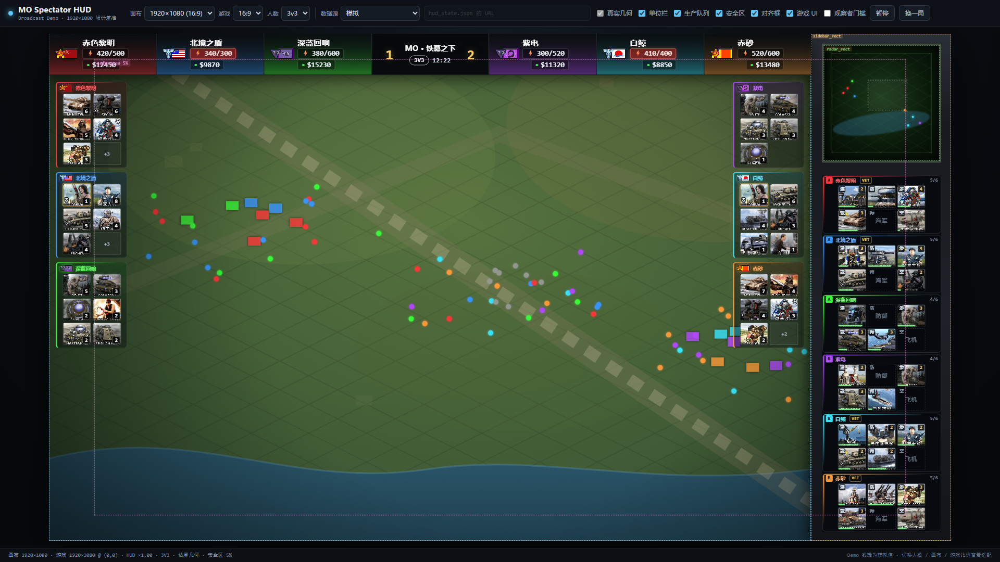
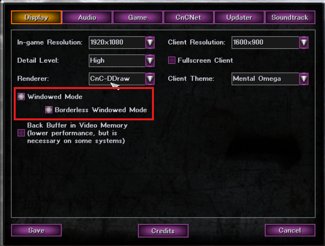
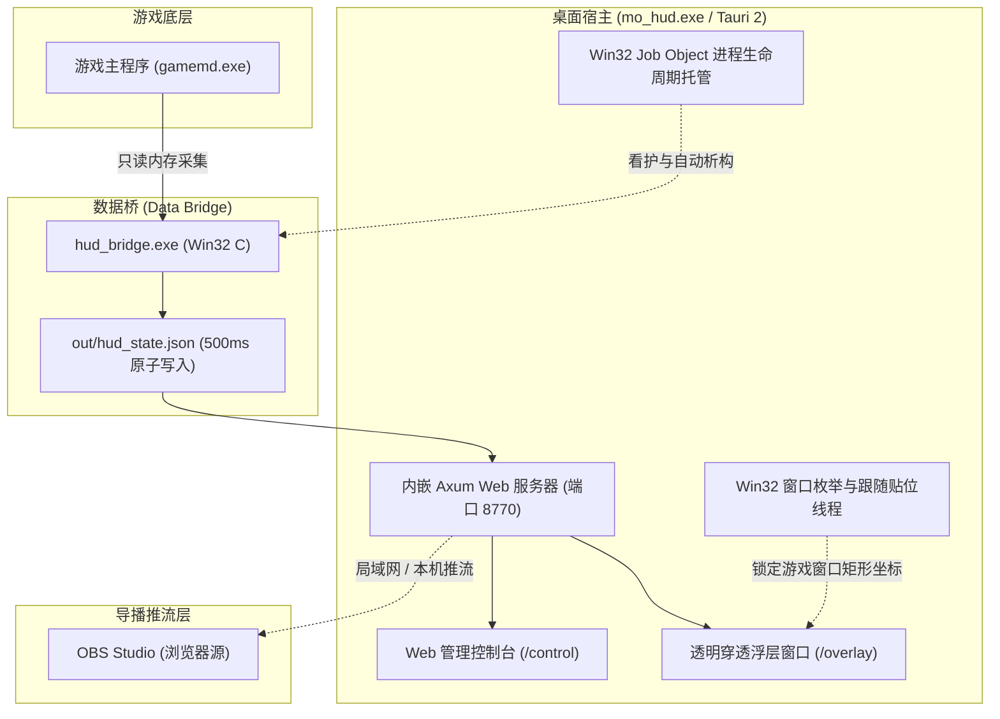

<div align="center">

# MO Spectator HUD
### 《心灵终结 3.3.6》实时观战 HUD 插件 / 赛事直播浮层系统

[](https://github.com/aaokok/mo-spectator-hud)
[](https://mentalomega.com)
[-FFC107?style=flat-square&logo=tauri&logoColor=black)](https://tauri.app)
[-4CAF50?style=flat-square)](https://github.com/aaokok/mo-spectator-hud)
[](LICENSE)

**专为《红色警戒2：尤里的复仇》大型 Mod《心灵终结 3.3.6》(Mental Omega 3.3.6) 打造的高性能观战数据透视与直播浮层系统。**  
采用“底层只读数据桥 + 统一渲染核心 + 双模输出（桌面透明浮层 / OBS 浏览器源）”的高内聚架构。

[✨ 核心功能](#features) • [⚠️ 运行先决条件](#prerequisites) • [🏗️ 架构设计](#architecture) • [🛠️ 源码构建与组装](#build) • [🚀 运行与使用](#usage) • [❓ 常见问题](#faq)

<br/>



</div>

> [!NOTE]
> **说明**：本项目为业余研究成果，开发过程中结合了 AI 辅助编写。可读性与可维护性可能存在不足，欢迎《心灵终结》玩家、解说及开发者提出建议或提交 PR 共同完善！

---

## 📖 目录

- [✨ 核心功能](#features)
- [⚠️ 运行先决条件](#prerequisites)
- [🏗️ 架构设计](#architecture)
- [🛠️ 源码构建与一键组装](#build)
- [🚀 运行与使用指南](#usage)
  - [方案 A：桌面客户端一键启动（推荐）](#usage-desktop)
  - [方案 B：OBS 导播推流配置](#usage-obs)
  - [方案 C：轻量 Python 独立服务（免客户端）](#usage-python)
- [📂 项目工程结构](#structure)
- [❓ 常见问题与排错 (FAQ)](#faq)
- [📜 免责声明](#disclaimer)
- [📄 开源协议](#license)

---

## <span id="features">✨ 核心功能</span>

### 1. 🎯 自适应赛事对局顶栏
- **对局规模自适应**：原生支持 1v1、2v2、3v3 动态平滑伸缩排版；
- **全要素战况透视**：直观展示玩家阵营旗帜、玩家名称、资金余额与实时电力看板；
- **电力过载告警**：电力负载/上限动态对比，发生供电不足时自动高亮报警；
- **比分与赛况看板**：支持自定义对局标题、BO 比分及游戏对局计时显示。

### 2. 📊 智能战况侧栏与建造队列
- **存活战力统计**：实时聚合两侧玩家战场上的战斗兵力、装甲载具与防御建筑统计；
- **小地图对齐队列**：严格对齐游戏右侧小地图宽度，实时展示建筑、兵营、战车工场、海军四大建造序列进度条；
- **全量 Cameo 图标映射**：内置 532 张单位图标字典，完美适配全阵营特色单位与建筑；
- **特色识别机制**：支持英雄专属光效标记与科技渗透变体图标自动切换。

### 3. 🖥️ 双模态展示形态（单一渲染核心）
- **桌面原生置顶浮层**：基于 Tauri 2 + Rust 构建，原生透明穿透、无感跟随游戏窗口移动与缩放；
- **OBS 直播无损拉流**：内嵌轻量高性能 Axum Web 服务，直接向 OBS 浏览器源输出 `http://127.0.0.1:8770/overlay`，天然透明，无需额外添加绿幕色键。

### 4. 🎛️ 实时 Web 管理控制台
- 内置独立控制后台（`/control`），观战员可随时在手机、平板或副屏调整对局参数；
- 支持动态修改队伍比分、选手名称、快速切换 1v1~3v3 布局、控制生产队列与单位侧栏显示开关、配置过滤规则并提供全链路环境自检。

### 5. 🛡️ 安全只读与生命周期守护
- **纯只读内存采集**：底层数据桥仅调用 Windows 原生 `ReadProcessMemory` API 读取公共对局状态，**无内存写入、无 DLL 注入、无钩子挂载**；
- **Windows Job Object 托管**：外壳宿主与数据桥通过作业对象绑定，游戏或插件退出时子进程绝对静默析构，不留后台残留。

---

## <span id="prerequisites">⚠️ 运行先决条件</span>

> [!IMPORTANT]
> **游戏必须以「窗口化」或「无边框窗口化」模式运行！**  
> 《尤里的复仇》若以传统的独占全屏模式（Exclusive Fullscreen）运行，DirectX 将独占显卡渲染管道，任何 Windows 桌面覆盖层（Overlay）均无法置顶显示在游戏画面上方。

### 推荐游戏设置（参考示意）：
在《心灵终结》启动器（Mental Omega Client）的 **Options -> Display** 中：
1. 渲染器推荐选择 **`CnC-DDraw`**；
2. 勾选 **`Windowed Mode`（窗口化模式）**；
3. 推荐同时勾选 **`Borderless Windowed Mode`（无边框全屏）**，既能获得全屏视觉，又可保证浮层正常置顶跟随。

<div align="center">



</div>

---

## <span id="architecture">🏗️ 架构设计</span>



---

## <span id="build">🛠️ 源码构建与一键组装</span>

> [!TIP]
> 本仓库为纯源码开源，**不提供任何预编译二进制成品**。请根据以下步骤完成本地编译与便携包组装：

### 1. 编译底层数据桥 (`hud_bridge.exe`)
- **环境需求**：Visual Studio 2019 / 2022（包含 C++ 桌面开发工作负载，x86 模式）。
- 进入 `src/bridge/` 目录运行批处理：
  ```cmd
  cd src/bridge
  build_bridge.bat
  ```
  编译完成后，将在 `src/bridge/` 目录下生成轻量原生的 `hud_bridge.exe`（约 178 KB）。

### 2. 编译桌面客户端外壳 (`mo_hud.exe`)
- **环境需求**：Rust 稳定版工具链（`cargo` / `rustc`）及 Windows 10/11 系统的 WebView2 运行环境。
- 进入 `src/app/` 目录执行 Release 构建：
  ```cmd
  cd src/app
  cargo build --release
  ```
  构建完成后，二进制产物位于 `src/app/target/release/mo_hud.exe`（经 LTO 优化后约 10 MB）。

### 3. 一键组装便携运行环境
在仓库根目录下，直接双击运行 **`pack.bat`**（或在终端执行）：
```cmd
pack.bat
```
脚本将自动完成二进制同步、前端资产复制、图标库与元数据字典迁移，在 `release/` 目录生成完整独立的便携包！

<details>
<summary><b>🔍 查看手动组装文件结构规范（点击展开）</b></summary>

若需手动组装，标准结构如下：
```text
release/
├── mo_hud.exe              # 自行编译的主程序 (来自 src/app/target/release/)
├── hud_bridge.exe          # 自行编译的数据读取桥 (来自 src/bridge/)
├── demo/                   # 渲染核前端 (复制自 src/overlay/)
├── hud/                    # 管理控制台前端 (复制自 src/console/)
├── icons/                  # Cameo 图标库 (复制自 assets/icons/)
├── icons_manifest.json     # 图标映射字典 (复制自 assets/icons_manifest.json)
├── heroes.json             # 英雄数据字典 (复制自 assets/heroes.json)
└── out/                    # 运行时动态数据目录 (新建空文件夹)
```
</details>

---

## <span id="usage">🚀 运行与使用指南</span>

组装好 `release/` 目录后，可根据使用场景选择以下任意方式：

### <span id="usage-desktop">方案 A：桌面客户端一键启动（推荐）</span>

1. 启动《心灵终结 3.3.6》游戏，确保进入对局画面（**窗口化运行**）；
2. 双击运行 `release/mo_hud.exe`；
3. 程序将自动拉起数据桥后台守护进程、启动本地 Web 服务，并在游戏画面上方浮现透明穿透 HUD 浮层；
4. 同时系统会自动弹出 Web 管理控制台窗口，可随时调整比分、配置队伍或查看环境自检状态。

### <span id="usage-obs">方案 B：OBS 导播推流配置</span>

适用于赛事直播、解说转播与录屏制作：

1. 启动 `release/mo_hud.exe`（提供后台服务）；
2. 打开 OBS Studio，在「来源」面板中点击 `+`，添加 **「浏览器」 (Browser Source)**；
3. 按照如下参数进行配置：

| 配置项 | 推荐设定值 | 说明 |
| :--- | :--- | :--- |
| **URL** | `http://127.0.0.1:8770/overlay` | 本地实时渲染流地址 |
| **宽度 (Width)** | `1920` | 建议与对局及推流画布分辨率保持 1:1 |
| **高度 (Height)** | `1080` | 建议与对局及推流画布分辨率保持 1:1 |
| **帧率 (FPS)** | `60`（或 `30`） | 保证动态建造进度条平滑流畅 |
| **自定义 CSS** | *(保持留空)* | 背景原生全透明，无需添加滤镜 |

4. 将该浏览器源置于游戏画面图层的正上方即可。

### <span id="usage-python">方案 C：轻量 Python 独立服务（免客户端）</span>

适合低配设备或无需桌面窗口置顶的纯直播环境：
1. 进入 `release/demo/` 目录（或源码 `src/overlay/`）；
2. 双击 `启动覆盖层.bat`（或在控制台执行 `python serve.py`）；
3. 按照控制台打印的提示地址填入 OBS 浏览器源即可。

---

## <span id="structure">📂 项目工程结构</span>

```text
mo-spectator-hud/
├── pack.bat                 # 便携 Release 包一键组装快捷脚本
├── scripts/
│   └── pack_release.bat     # 自动化打包与资产同步脚本
├── docs/
│   └── images/              # 说明文档预览图与视觉资源
├── src/
│   ├── bridge/              # 底层数据桥 (Win32 C 原生实现)
│   │   ├── hud_bridge.c     # 内存只读遍历与状态序列化
│   │   ├── build_bridge.bat # MSVC x86 快速编译脚本
│   │   └── README.md
│   │
│   ├── app/                 # 桌面宿主壳 (Tauri 2 + Rust)
│   │   ├── Cargo.toml       # 依赖声明 (Axum / Windows API / Tokio)
│   │   ├── tauri.conf.json  # 窗口属性与嵌入配置
│   │   └── src/             # 窗口贴位跟随、Axum 路由与 Job 托管
│   │
│   ├── overlay/             # HUD 浮层渲染核心 (HTML / CSS / JS)
│   │   ├── index.html       # 核心渲染入口
│   │   ├── demo.js          # UI 驱动与动效控制
│   │   ├── live-data.js     # 数据适配层 (hud_state.json → 视图模型)
│   │   ├── mock-data.js     # 本地离线开发模拟数据集
│   │   └── serve.py         # 独立轻量 HTTP 调试服务
│   │
│   └── console/             # 观战 Web 控制台
│       ├── control.html     # 控制台主页面
│       └── pages/           # 概览、画面控制、过滤规则与自检面板
│
├── assets/                  # 共享静态资源
│   ├── icons/               # 532 张单位 Cameo 图标 (含 byid/ 索引)
│   ├── icons_manifest.json  # 图标 ID 与名称映射字典
│   └── heroes.json          # 英雄口径与专属光效配置
│
└── release/                 # 便携运行发布目录 (供自行编译产物放置)
    ├── README.md            # 发布包组装指引
    └── .gitkeep             # 目录占位保持
```

---

## <span id="faq">❓ 常见问题与排错 (FAQ)</span>

<details>
<summary><b>Q1: 运行了客户端，为什么游戏画面上看不到 HUD 浮层？</b></summary>

1. **检查游戏是否为窗口化**：请务必确保《心灵终结》设置了窗口化运行或无边框窗口化；如果是独占全屏，浮层会被游戏画面强制覆盖在底层。
2. **检查是否在对局内**：主菜单与战役选关界面无对战数据，进入实际战斗地图后 HUD 将自动唤醒显示。
</details>

<details>
<summary><b>Q2: 杀毒软件提示报毒或拦截是怎么回事？</b></summary>

本项目底层数据桥 `hud_bridge.exe` 需要调用 Windows API `ReadProcessMemory` 读取 `gamemd.exe` 的公共对局数据。部分安全软件会对跨进程读取内存行为产生启发式误报。本项目源码完全公开透明，不包含任何恶意行为，请放心添加信任或放行。
</details>

<details>
<summary><b>Q3: HUD 上的金钱、电力、单位数量为什么显示为 0 或不更新？</b></summary>

1. 确认游戏版本为标准的《心灵终结 3.3.6》；
2. 打开 Web 控制台（`http://127.0.0.1:8770/control`），切换到 **「环境自检」** 页面查看数据桥运行状态和最新快照时间戳；
3. 检查 `release/out/hud_state.json` 是否在正常产生数据。
</details>

<details>
<summary><b>Q4: 鼠标指针指示器显示异常？</b></summary>

当前版本控制台中「画面」页签下的 *“鼠标指针指示器”* 与 *“仅在遮挡时显示指针”* 属于实验性功能，在部分多屏幕/高 DPI 缩放场景下可能存在坐标偏差，建议在实际直播或比赛中保持默认关闭。
</details>

---

## <span id="disclaimer">📜 免责声明</span>

1. 本项目为非官方开源衍生工具，仅供《命令与征服：尤里的复仇》大型 Mod《心灵终结 3.3.6》赛事观战、解说直播与复盘学习交流使用。
2. 数据桥严格采用**只读内存采集**，不提供任何修改游戏内存、辅助操作或影响平衡性的作弊功能。请勿用于破坏游戏公平竞赛的任何行为。
3. 《心灵终结》(Mental Omega) 及其涉及的游戏相关图形、音频与美术资产版权归原制作团队所有。

---

## <span id="license">📄 开源协议</span>

本项目基于 [MIT 许可证](LICENSE) 授权开源。
