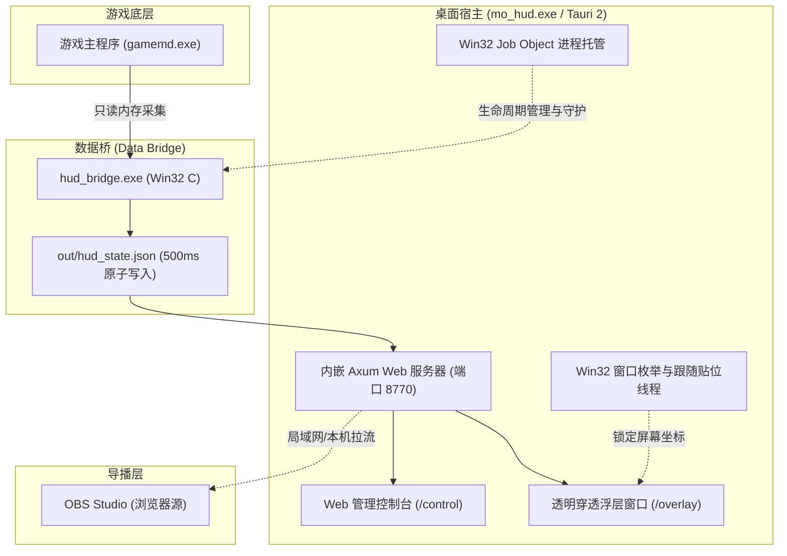

# MO Spectator HUD · 心灵终结 3.3.6 观战 HUD 插件

[](https://github.com)
[](https://mentalomega.com)
[](https://tauri.app)
[](LICENSE)

**MO Spectator HUD** 是专为《命令与征服：尤里的复仇》知名大型 Mod《心灵终结 3.3.6 (Mental Omega 3.3.6)》打造的现代化观战实时浮层系统。系统采用**“底层只读数据桥 + 统一渲染核心 + 双外壳（桌面透明浮层 / OBS 浏览器源）”**的高内聚架构，为赛事直播、导播解说与回放复盘提供赛事实时数据透视与 UI 渲染。

---

## ✨ 核心特性

- 🎯 **自适应赛事顶栏**：根据对局规模（1v1 ~ 4v4）自适应调整紧凑度。清晰展示玩家阵营旗帜、ID、电力状态（消耗/上限对比，超载高亮告警）、资金余额与自定义比分看板。
- 📊 **智能侧栏与生产队列**：
  - 两侧悬浮展示各玩家存活战斗单位与防御设施实时统计；
  - 生产队列紧密对齐小地图宽度，实时展示正在建造的单位与进度；
  - 英雄登场呼吸光效与渗透科技变体图标自动切换。
- 🖥️ **双形态展示与零第二套渲染器**：
  - **桌面覆盖层**：基于 Tauri 2 + Rust，原生支持透明穿透、窗口置顶并毫秒级跟随游戏窗口贴位；
  - **OBS 直播推流**：内置 Axum 本地 Web 服务，直接提供 `/overlay` 地址给 OBS 浏览器源，天然透明免抠色键。
- 🎛️ **实时 Web 管理控制台**：一键切换 1v1~4v4 布局、动态配置比赛名与局分、单位栏开关、阵营/单位过滤规则及自动化环境自检。
- 🛡️ **安全只读与轻量化**：底层数据桥仅对游戏进程做只读（`ReadProcessMemory`）快照采集，Windows Job Object 进程树看护，不修改游戏内存或注入钩子，游戏退出即自动析构。

---

## 🏗️ 架构设计



---

## 🚀 快速使用（编译免安装版）

进入仓库的 `release/` 目录即可开箱即用：

### 方案 1：客户端一键启动（推荐）
1. 启动游戏《心灵终结 3.3.6》并进入对局（或打开回放录像）；
2. 双击运行 `release/mo_hud.exe`；
3. 程序将自动托管数据桥、启动内嵌服务，并在游戏画面上方浮现透明 HUD 覆盖层；
4. 同时会自动弹出 Web 控制台窗口，可随时修改比赛名、局分或排查环境；
5. **快捷键**：
   - <kbd>Ctrl</kbd> + <kbd>Alt</kbd> + <kbd>H</kbd> ：显隐 HUD 覆盖窗口
   - <kbd>Ctrl</kbd> + <kbd>Alt</kbd> + <kbd>T</kbd> ：置顶 / 取消置顶

### 方案 2：OBS 直播导播推流
1. 运行 `release/mo_hud.exe` 启动服务；
2. 在 OBS 来源面板中添加 **「浏览器」 (Browser Source)**；
3. 参数配置：
   - **URL**：`http://127.0.0.1:8770/overlay`
   - **宽度**：`1920` / **高度**：`1080`（建议与游戏主分辨率一致）
   - **帧率**：`30` 或 `60`
4. 背景天然全透明，无需添加色键滤镜即可完美叠放在游戏画面上。

### 方案 3：轻量 Python 独立服务（无客户端）
若不想运行桌面窗口，仅需供 OBS 采集：
1. 打开 `src/overlay/` 目录；
2. 运行 `启动覆盖层.bat`（或执行 `python serve.py`）；
3. 复制终端中输出的地址填入 OBS 浏览器源即可。

---

## 📂 目录结构说明

```text
mo-spectator-hud/
├── .gitignore               # 排除构建缓存、动态运行日志与私有配置
├── README.md                # 统一项目说明文档
├── LICENSE                  # MIT 开源协议
│
├── src/                     # 源码目录
│   ├── bridge/              # 底层只读数据桥 (Win32 C 原生实现)
│   │   ├── hud_bridge.c     # 内存字段采集与状态序列化
│   │   ├── build_bridge.bat # MSVC x86 快速构建脚本
│   │   └── README.md
│   │
│   ├── app/                 # 桌面客户端外壳 (Tauri 2 + Rust)
│   │   ├── Cargo.toml       # Rust 依赖声明
│   │   ├── tauri.conf.json  # Tauri 窗口属性与静态资源映射
│   │   └── src/             # Axum 服务、窗口跟随、托盘与 Job 托管
│   │
│   ├── overlay/             # HUD 浮层渲染核心 (HTML / CSS / JS)
│   │   ├── index.html       # 唯一渲染核主入口
│   │   ├── demo.js          # UI 渲染驱动与数据更新通道
│   │   ├── live-data.js     # 数据适配层 (hud_state.json → 视图模型)
│   │   ├── serve.py         # 独立轻量 HTTP 桥接服务器
│   │   └── assets/          # 旗帜图与公共特效资产
│   │
│   └── console/             # Web 控制台管理面板
│       ├── control.html     # 观战员控制台前端
│       └── pages/           # 概览、显示、单位过滤与日志模块
│
├── assets/                  # 共享静态资源
│   ├── icons/               # 532 张单位 Cameo 图标 (含 byid/ 索引)
│   ├── icons_manifest.json  # 图标元数据映射表
│   └── heroes.json          # 英雄单位口径与特效映射
│
└── release/                 # 预编译免安装独立发布包
    ├── mo_hud.exe           # Tauri 2 启动器二进制文件
    ├── hud_bridge.exe       # 数据桥二进制文件
    ├── demo/                # 浮层静态资源
    ├── hud/                 # 控制台静态资源
    ├── icons/               # 运行时图标库
    ├── out/                 # 动态数据输出目录 (.gitkeep 占位)
    └── 使用说明.txt
```

---

## 🛠️ 源码构建指南

### 1. 编译底层数据桥 (`hud_bridge.exe`)
- 环境需求：安装了 C++ 工具链的 Visual Studio（x86 模式）。
- 进入 `src/bridge/`，直接运行：
  ```cmd
  build_bridge.bat
  ```

### 2. 编译桌面客户端 (`mo_hud.exe`)
- 环境需求：Rust 工具链（`cargo` / `rustc`）与系统 WebView2。
- 进入 `src/app/`：
  ```cmd
  cargo build --release
  ```
- 编译产物位于 `target/release/mo_hud.exe`。

---

## ⚠️ 免责声明

1. 本项目仅供《心灵终结 3.3.6》赛事观战、解说录播与对局复盘使用。
2. 数据桥采用只读方式读取公共对局状态，请勿将其用于非法用途或破坏游戏公平竞争环境。
3. 《心灵终结》(Mental Omega) 相关美术资源归属原制作组与 EA 所有。

---

## 📄 开源许可证

本项目采用 [MIT 许可证](LICENSE) 授权。
